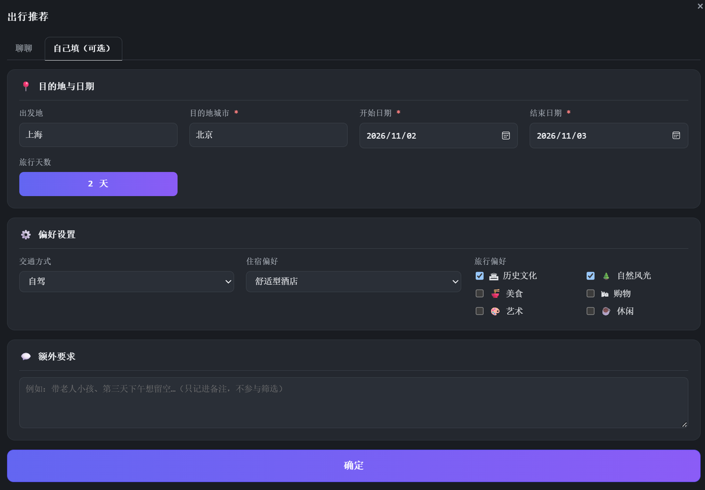
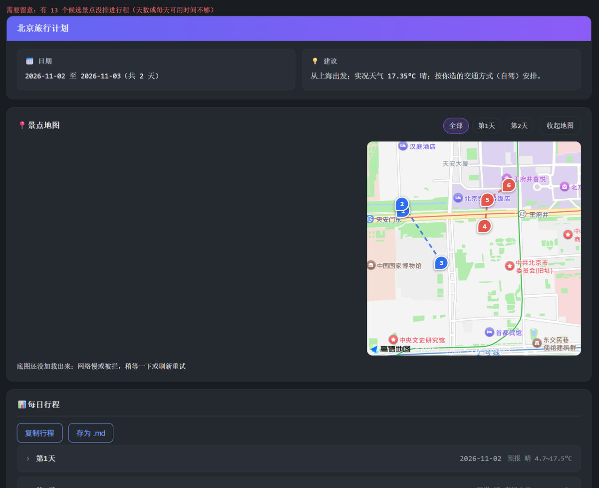
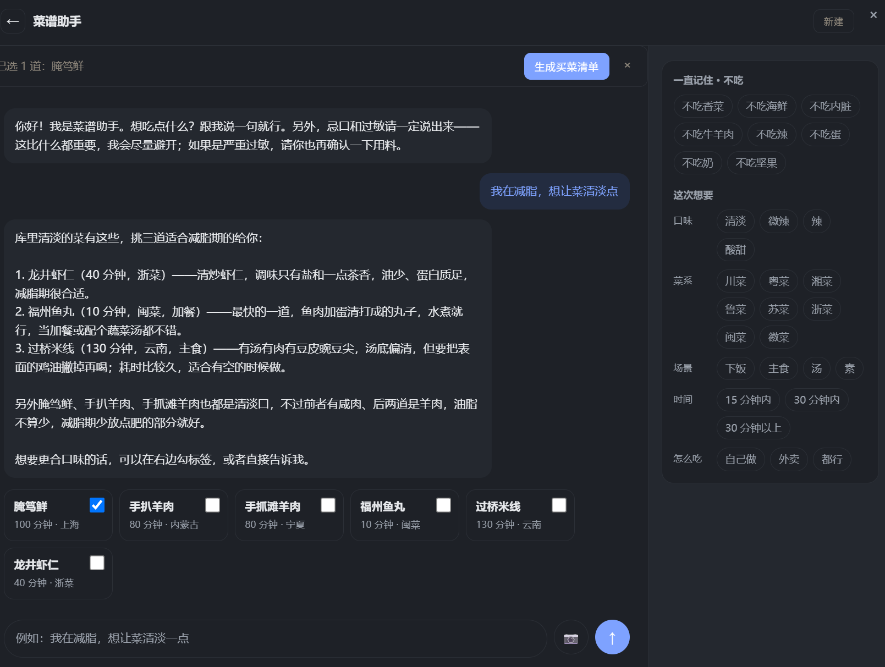

# 桌宠 

[](https://github.com/korina06/Pet_desktop/actions/workflows/checks.yml)


一个住在桌面上 karo。
目前还有很多小功能未完善或开发，后续有时间更新


能聊天、记签到、管菜谱、规划出行。后端 FastAPI + SQLite，
前端是原生 HTML/CSS/JS，没有构建步骤。

这个项目最花心思的地方有三处：

- **数据只信接口和数据库。** 菜谱卡片按 id 回库取；景点、餐厅、酒店字段都是接口原样返回，
  模型只决定挑哪几个、说一句为什么。
- **拿不到就说拿不到。** 缺数据会写在界面上。门票、房价、人均消费这些没有数据源的东西，
  数据模型里干脆没有这个字段。
- **约束落在代码里。** 忌口、时间上限、工具白名单由服务端强制合并，提示词只是让模型知道有这回事。

过程记录：每步的需求与理由在 `docs/DECISIONS.md`，实测并发与耗时在 `docs/PERF.md`，
一次完整复盘在 `docs/FAILURES.md`，规模与数据量在 `docs/SCALE.md` 。

## 看看它长什么样

<p align="center"></p>

<p align="center"></p>

<p align="center"></p>

<p align="center"></p>

## 跑起来

```powershell
powershell -ExecutionPolicy Bypass -File scripts\start.ps1
```

它建 venv、装依赖、缺 `.env` 就从 `.env.example` 复制、然后起服务。也可以手动：

```powershell
.venv\Scripts\python.exe -m pip install -r requirements.txt
copy .env.example .env      # 至少填 DEEPSEEK_API_KEY、HEFENG_API_HOST / HEFENG_API_KEY、GAODE_API_KEY
.venv\Scripts\python.exe -m uvicorn main:app --reload
```

浏览器打开 <http://127.0.0.1:8000>。

默认只监听本机，鉴权默认关着：`AUTH_TOKENS` 留空时就是单机模式，`session_id` 即全部凭据，
谁连得上谁就能读写任意会话。自己用足够，别把端口直接暴露出去。
`scripts/start.ps1` 里写死了 `--host 127.0.0.1`，手动起服务时也别加 `--host 0.0.0.0`。

要给别人用就配 `AUTH_TOKENS`（见下面的配置表）：配了之后 `/api/*` 一律要
`Authorization: Bearer`，会话按 owner 隔离，还能按 token 限流、校验 Origin。

## 有什么

| 窗口 | 能做的事 |
|---|---|
| 聊天 | 流式回复，工具调用并发；历史落库，重开窗口还在 |
| 食谱 | 问菜谱、上传图片识菜、生成买菜清单；忌口与时间上限由服务端注入 |
| 出行 | 先聊需求（模型调工具，可以贴路线图），或用表单生成确定性行程；带交互地图、导出 |
| 签到 | 真日历，带农历、节日、放假调休 |
| 邮箱 | 只读收件箱、星标、新邮件气泡提醒 |

轮盘里可以切模型（DeepSeek / 智谱 / MiMo），出行不受影响 —— 它不靠模型排程。

## 几个关键决定

**出行：对话是入口，计划由代码生成。** 表单那条路是确定性流水线（地理编码 → 天气 → POI →
路线 → 装箱），可单测、可复现。不让模型排行程有三个具体原因：它可能跳过 POI 查询而不报错，
`agent_max_steps` 不够走完一轮，排行程本质是装箱问题、交给代码才对得上测试。对话这条路
负责问清需求、查实时数据、把路线画出来，但它产不出 `trip_id`，所以没有计划概览和导出。

**菜谱：模型负责选，数据一律回库。** 模型编不出库里没有的菜。检索参数里的忌口只做并集、
时间上限直接覆盖，勾选什么就查什么。参数在工具边界按 JSON Schema 校验，`"30"` 会矫正成 `30`，
`"abc"` 直接回一句可读的错误给模型，不会静默当成没有这个条件。

**加一个工具要写三处。** `BaseTool` 子类、`tools/registry.py` 注册、再在
`CHAT_TOOLS` / `TRAVEL_TOOLS` / `RECIPE_TOOLS` 里显式写上 —— 新工具不会自动出现在所有窗口里，
谁能看见什么是明确决定的。

## 外部服务（可选）

天气、地图、图片、识菜之外，还能接几台 MCP 服务器：车次、黄历、航班、联网搜索。
只改配置不改代码：

```dotenv
MCP_12306_URL=https://mcp.api-inference.modelscope.net/xxxx/sse
MCP_SERVERS=[{"name":"bazi","url":"https://mcp.api-inference.modelscope.net/aaa/sse","token":"ms-xxx"}]
```

接法：`/sse` 结尾走 SSE，其余走 streamable HTTP。服务器声明了哪些工具就注册哪些，参数照抄它的
`inputSchema`；某台挂了只影响它自己，启动时打一行 WARN。第一次接一台新的，先跑

```powershell
python scripts\mcp_remote_probe.py <地址> --token <令牌>
```

看一眼它有哪些工具，再填进 `.env`。工具清单缓存在 `data/mcp_tools.json`，换了地址或者远端改了
工具要重跑一次。黄历和搜索各有一个开关（`MCP_ALMANAC_SERVER` / `MCP_WEB_SEARCH_SERVER`），
填上那台的名字才会换上按区间查的 `search_almanac` 和只回标题摘要的 `search_web`。

车次只转述车次与时刻，余票不转给模型 —— 那是实时跳动的快照，转述一次就可能被当成还有票。

## 配置

完整清单在 `.env.example`，有测试保证它覆盖 `core/config.py` 的每个字段。

必填：

| 变量 | 用途 |
|---|---|
| `DEEPSEEK_API_KEY` | 聊天与 Agent |
| `HEFENG_API_HOST` / `HEFENG_API_KEY` | 天气 |
| `GAODE_API_KEY` | 地理编码、POI、路线（控制台里类型选「Web 服务」） |

模型：

| 变量 | 默认 / 说明 |
|---|---|
| `DEEPSEEK_BASE_URL` / `DEEPSEEK_MODEL` | `api.deepseek.com` / `deepseek-chat` |
| `GLM_API_KEY` | 填了才能在「模型」里切到智谱 |
| `GLM_BASE_URL` / `GLM_MODEL` | `open.bigmodel.cn/api/paas/v4` / `glm-4-flash` |
| `GLM_EMBEDDING_MODEL` / `EMBEDDING_ENABLED` | 语义召回用的嵌入模型（`embedding-3`）/ 总开关（`1`） |
| `MIMO_API_KEY` / `MIMO_BASE_URL` / `MIMO_MODEL` | 地址和模型名都填了，MiMo 才会出现在模型列表里 |

数据源：

| 变量 | 默认 / 说明 |
|---|---|
| `GAODE_JS_KEY` / `GAODE_JS_SECURITY_CODE` | 行程里的交互地图（类型选「Web端(JS API)」）；安全密钥只在服务端用 |
| `UNSPLASH_API_KEY` | 景点配图（填 Access Key） |
| `SERPAPI_API_KEY` | 上传图片识菜 |
| `DEFAULT_CITY_LAT` / `DEFAULT_CITY_LON` | 天气工具缺坐标时的兜底城市，默认北京 |

MCP（都不填就只用自己的接口）：

| 变量 | 默认 / 说明 |
|---|---|
| `MCP_12306_URL` | 填了多一个 `search_trains` |
| `MCP_12306_TOKEN` / `MCP_12306_TIMEOUT_SECONDS` | 令牌 / 单次超时（20 秒） |
| `MCP_12306_EXTRA_TOOLS` | 同一台上额外暴露的工具，默认 `query-ticket-price,get-current-time` |
| `MCP_SERVERS` | 其它服务器，JSON 数组一行写完：`name` / `url` / `token` / `timeout_seconds` / `tools` |
| `MCP_TOOLS_CACHE` | 远端工具清单缓存，默认 `data/mcp_tools.json` |
| `MCP_ALMANAC_SERVER` / `MCP_WEB_SEARCH_SERVER` | 哪台管黄历 / 联网搜索（填 `name`） |

行为与预算：

| 变量 | 默认 / 说明 |
|---|---|
| `AGENT_MAX_STEPS` | Agent 最多往返几次，4 |
| `CHAT_DEADLINE_SECONDS` | 聊天一轮的服务端上限，90 秒 |
| `TRIP_DEADLINE_SECONDS` / `RECIPE_DEADLINE_SECONDS` | 出行 / 食谱生成上限，25 / 35 秒 |
| `TRIP_CHAT_MAX_STEPS` / `TRIP_CHAT_DEADLINE_SECONDS` | 出行对话的步数（6）与单轮上限（60 秒） |
| `SESSION_MAX_MESSAGES` | 喂给模型的上下文条数，40 |
| `MAX_OUTPUT_TOKENS` | 单次输出上限，1000 |
| `TURN_TOKEN_BUDGET` / `TRIP_CHAT_TURN_TOKEN_BUDGET` | 单轮软预算，20000 / 60000，0 不限 |
| `DAILY_TOKEN_WARN` | 单日告警阈值，0＝关闭；只告警不拒绝 |
| `PET_ADDRESS` | 怎么称呼你，默认「哥哥」 |
| `PET_DB_PATH` / `PET_IMAGE_DB` | `data/pet.db` / `data/recipe_images.db` |

对外访问（多用户时才需要）：

| 变量 | 默认 / 说明 |
|---|---|
| `ALLOWED_HOSTS` | 只接受这些 Host，默认本机回环，挡 DNS rebinding |
| `AUTH_TOKENS` | `alice:token-a,bob:token-b`；留空＝关闭，单机模式 |
| `AUTH_RATE_LIMIT` | 每个 token 每 60 秒的请求上限，0 不限 |
| `AUTH_ALLOWED_ORIGINS` | 允许的 Origin，空＝不校验 |

配了 `AUTH_TOKENS` 之后 `/api/*` 都要 `Authorization: Bearer`，会话按 owner 隔离。
前端第一次收到 401 会弹一次输入框，token 存在本机 `localStorage`；同一份 token 还写一个
`SameSite=Strict` 的同源 cookie，因为 `` 带不了请求头，缩略图和路线图靠它过鉴权。

## 数据在哪

聊天和食谱的对话、签到记录、菜谱库、图片索引、忌口与口味画像、应用设置、模型调用账本
都在 `data/pet.db`（图片在 `data/recipe_images.db`）。关窗口、重启都还在。

行程和邮箱登录态只在内存里，重启清空 —— 邮箱那条是故意的，凭据不该落盘。

| | 条数 | 说明 |
|---|---|---|
| 喂给模型的上下文 | 40 | `SessionStore.max_messages` |
| 界面能翻到的历史 | 200 | `history.MAX_ROWS_PER_SESSION` |

这两个不是一回事，混用会让上下文无界增长。聊天窗口右上角的 🗑 只清当前会话的聊天记录，
忌口和菜谱库不动。备份用 `python scripts\backup_data.py`，打的是 SQLite 的一致性快照。

`open_storage()` 打不开库时会降级成内存库并记一条 warning，那时历史重启就没了，日志在
`data/logs/app.log`。

## 怎么测

```powershell
.venv\Scripts\python.exe scripts\check_frontend.py   # 主路径，裸解释器也能跑
.venv\Scripts\python.exe -m pytest -q                # 带 fixture 的文件只有这条跑得到
.venv\Scripts\python.exe scripts\eval_agent.py       # Agent 场景，脚本化模型，不花钱
python -m ruff check .                               # 规则在 ruff.toml
python scripts\smoke_browser.py                      # 真浏览器烟测（本机要有 Chrome/Edge）
```

`check_frontend.py` 和 `pytest` **两条都要跑**：前者是自己写的一体化验证（领域模型、流水线、
前端结构、用 DOM 桩真执行 `app.js`），但不支持 fixture，所以像 `test_deepseek_llm` 这种只有
pytest 跑得到。两边的用例有重叠，对外只说各自通过多少，别相加。

`eval_agent.py` 验的是一整轮的不变量：该不该调工具、参数对不对、失败有没有回灌、步数有没有失控。
`e2e_real.py --yes` 才是真模型 + 真库，会花钱，默认不跑。

## 性能

`python scripts\bench_local.py --rounds 100` 出本地基准，`python scripts\load_test.py` 出并发。

这些数字量的是**我们自己的代码**有多快：外部调用和模型都是替身，不含网络与模型延迟。
同样的原因，`load_test.py` 回答的是「这套服务能扛多少」，不是「上游能扛多少」。
具体数字和重现命令都在本机的 `docs/PERF.md`（私人笔记，不进仓库），命令本身在 `scripts/load_test.py`。

## 目录

```
agents/   Agent 循环、模型路由、人设提示词
api/      接口层：参数校验、组装依赖、响应模型
core/     领域逻辑：行程流水线与装箱、菜谱库、邮箱协议、签到、SQLite 封装
tools/    外部数据源与工具注册表（高德 / 和风 / Unsplash / SerpAPI / MCP）
static/   原生前端：index.html / style.css / app.js
tests/    测试，与 scripts/check_frontend.py 共用
scripts/  check_frontend.py、verify_*.js、start.ps1、备份与探针
data/     运行时生成：库、图片库、日志（不入库）
docs/     决策记录与设计文档
```

## 已知限制

- **聊天产不出计划。** 聊出来的回答、路线图、存疑名单都不落成 `trip_id`，要计划概览、地图、
  导出就用表单重新生成。把对话转成计划的按钮还没做。
- **天气分两种。** 实况是当下观测，逐日预报来自和风、最多 10 天且是预报不是观测；超过 10 天
  界面上直接说没有，不插值。`duration_min` 是按类型估算的。门票、房价、人均没有数据源。
- **过敏只能保证「尽量」。** 匹配是菜名加食材的文本匹配，外加一张手工大类表，不覆盖调料、
  腌料和交叉污染。严重过敏请自己再确认一遍。
- **并发是单机自用的取舍。** 接口是 async 的，SQLite 是同步的，一次查询会占住事件循环；
  负载测试下事件循环最多被占住十来毫秒，所以没改成 `asyncio.to_thread`。真要多用户部署再动。
- **注入防不住，但绕不过约束。** 测试验的是注入拿不到数据、放不开忌口、调不动没授权的工具，
  不是「模型一定听话」。
